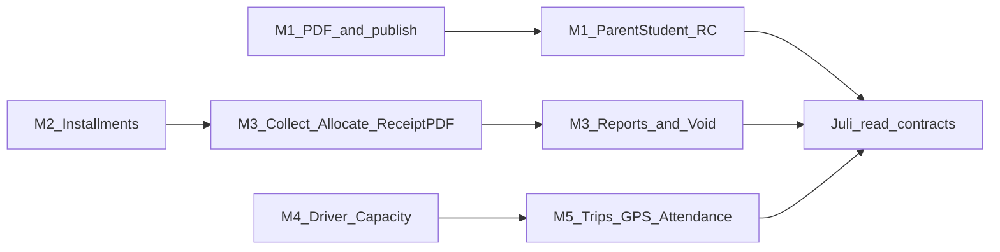

# School Admin ERP — Five Modules Implementation Plan

**Date:** 2026-10-29  
**Companion audit:** [`school-admin-erp-modules-api-audit.md`](./school-admin-erp-modules-api-audit.md)  
**Test plan:** [`school-admin-erp-modules-test-plan.md`](./school-admin-erp-modules-test-plan.md)  
**Ops notes (post-wave):** [`SCHOOL_ADMIN_ERP_MODULES_NOTES.md`](./SCHOOL_ADMIN_ERP_MODULES_NOTES.md)

This document specifies endpoints, schemas, RBAC, migrations, Vishal/Juli contracts, and delivery sequence for Modules 1–5. It is a **planning / contract** artifact. Application changes for the wave live under Alembic `20261029_0041` and related services; **do not apply that revision to Neon without explicit approval.**

---

## Goals and non-goals

### Goals

1. Report cards: PDF generation, publication-consistent portal reads (`Exam.publish`).
2. Fee structures: installment schedules summing to structure total (INR 2dp).
3. Fee collection: installment allocation, receipts/PDFs, collection reports, audited cancel.
4. Transport master: driver/helper staff FKs, capacity on student assign.
5. Bus tracking: trips, authenticated staff GPS, boarding/drop-off, parent HTTP poll.

### Non-goals

- School fee online gateway / Razorpay school checkout.
- WebSocket live maps, GPS hardware, push notifications.
- Refund / money-movement reverse (cancel only).
- Renaming flat admin paths to `/transport/*`.
- Changing Super Admin SaaS billing.
- Restoring or recreating `admin-web`.
- Silent mutation of historical obligations, payments, receipts, or published results.

---

## Locked product defaults

| Decision | Default |
|----------|---------|
| Installment sum | Must equal structure total; INR `Numeric(12,2)` / `ROUND_HALF_UP` |
| Overpayments | Disabled |
| Online school fee gateway | Out of scope; keep SaaS Razorpay as-is |
| Report-card publication | Reuse `Exam.publish` (no separate RC publish flag unless later approved) |
| Driver auth | Existing authenticated staff login |
| Live tracking transport | HTTP polling only |
| API paths | Preserve existing school-admin paths; add additive routes |
| Structure/installment edits after allocations | **409** if installments already have success allocations |
| Cancel semantics | Soft-delete payment + allocations; `cancelled_at` / `cancel_reason`; audit log; no refund |

---

## Delivery sequence

**Recommended order:** M1 PDF + publish reads → M2 installments → M3 allocate/receipt/reports/cancel → M4 drivers/capacity → M5 trips/GPS/attendance → Juli portal reads + regression.

---

## Architecture (extend, do not duplicate)

| Layer | Location |
|-------|----------|
| Admin routes (existing) | [`school_admin_mgmt.py`](../app/api/v1/school_admin_mgmt.py) |
| Admin ERP additive routes | [`school_admin_erp.py`](../app/api/v1/school_admin_erp.py) mounted from [`school_admin.py`](../app/api/v1/school_admin.py) |
| Core fee/transport CRUD | [`school_academic_mgmt.py`](../app/services/v1/school_academic_mgmt.py) |
| ERP fee ops | [`school_erp_fees.py`](../app/services/v1/school_erp_fees.py) |
| ERP report cards | [`school_erp_report_cards.py`](../app/services/v1/school_erp_report_cards.py) |
| ERP transport ops | [`school_erp_transport.py`](../app/services/v1/school_erp_transport.py) |
| Staff driver | [`staff_transport.py`](../app/api/staff_transport.py) → `/api/staff/transport` |
| Student/parent portal | [`student_erp_reads.py`](../app/api/student_erp_reads.py) → `/api/student|parent/...` |
| Models | [`tables.py`](../app/models/tables.py) |
| Migration | `alembic/versions/20261029_0041_school_admin_erp_modules.py` |

---

## Module 1 — Report cards and grading

### Keep

- Grading scales CRUD: `/grading-scales*`
- Generate/list/get: `POST/GET /report-cards`, `GET /report-cards/{id}`
- Offline exam process + existing student offline result reads

### Add

| Method | Path | Permission | Notes |
|--------|------|------------|-------|
| GET | `/api/v1/school-admin/report-cards/{report_id}/pdf` | `exams.manage` | `application/pdf` via FPDF |
| GET | `/api/student/report-cards` | Student session | Published only (`Exam.publish`) |
| GET | `/api/student/report-cards/{report_id}` | Student session | Own student only |
| GET | `/api/student/report-cards/{report_id}/pdf` | Student session | Same gate |
| GET | `/api/parent/children/{student_id}/report-cards` | Parent session | Guardian-linked child |
| GET | `/api/parent/children/{student_id}/report-cards/{report_id}` | Parent session | |
| GET | `/api/parent/children/{student_id}/report-cards/{report_id}/pdf` | Parent session | |

**PDF content (minimum):** school name, student, exam, subjects from `subjects_json`, percentage, letter grade, pass/fail.

**Publish rule:** Portal APIs return 404 when `Exam.publish` is false (same pattern as offline results).

---

## Module 2 — Fee structures / installments

### Schema

`fee_installments`: `school_id`, `structure_id`, `name`, `due_date`, `amount Numeric(12,2)`, `sort_order`, `deleted_at`, timestamps.

### Endpoints

| Method | Path | Permission | Body / notes |
|--------|------|------------|--------------|
| GET | `/fee-structures/{structure_id}/installments` | `fees.manage` | Items include `allocated` / `outstanding` |
| PUT | `/fee-structures/{structure_id}/installments` | `fees.manage` | Replace schedule; sum == structure total or **422**; allocations exist → **409** |
| POST | `/fee-structures` (existing) | `fees.manage` | Optional `installments` array on create |

### Rules

- Each installment `amount > 0`; name and `due_date` required.
- Sum of installment amounts must equal sum of active `fee_structure_amounts` (INR 2dp).
- Soft-delete prior installments on replace only when none have success allocations.
- Do not mutate historical paid allocations when editing structure amounts for already-paid work.

---

## Module 3 — Fee collection, receipts, reports, cancel

### Collect (extend existing)

`POST /fees/collect` — keep path and body (`assignment_id`, `amount`, `method`, optional `idempotency_key`, `receipt_no`, `paid_on`, …).

After insert of `FeePayment` (`status=success`):

1. Reject amount > outstanding balance (**422**).
2. Allocate earliest-due installment first via `FeePaymentAllocation`.
3. Any leftover after installments (e.g. concession edge) may land as `installment_id=null` unallocated line — overpay still blocked at collect.

### New / additive endpoints

| Method | Path | Permission | Notes |
|--------|------|------------|-------|
| GET | `/fee-payments/{payment_id}/receipt` | `fees.manage` | JSON receipt + allocation lines |
| GET | `/fee-payments/{payment_id}/receipt/pdf` | `fees.manage` | FPDF |
| POST | `/fee-payments/{payment_id}/cancel` | `fees.manage` | Body `{ "reason": "…" }` required |
| GET | `/fees/collection-report` | `fees.manage` | Query `from_date`, `to_date`, optional `class_id` |

### Cancel semantics

- Only `success` non-deleted payments.
- Set `status=cancelled`, `cancelled_at`, `cancel_reason`, `deleted_at`; soft-delete allocations.
- Write `AuditLog` action `fee_payment.cancel`.
- **No** refund, gateway reverse, or inventing credit notes.

### Balance definition (preserve history)

- Payable = structure total − concession.
- Collected = sum of `FeePayment` with `status=success` and `deleted_at IS NULL`.
- Outstanding = payable − collected.
- Legacy payments without allocation rows remain valid under this definition.

---

## Module 4 — Transport master data

### Schema changes

On `transport_vehicles`: nullable `driver_staff_id`, `helper_staff_id` → `staffs.id` (same school).

### Behavior

- Create/update vehicle accept `driver_staff_id` / `helper_staff_id`; validate staff belongs to school.
- `POST /student-transport-assignments`: before insert, count active assignments across all routes sharing the vehicle; if `capacity` set and count ≥ capacity → **409**.
- Keep paths: `/vehicles`, `/transport-routes`, `/transport-stops`, `/student-transport-assignments`.

---

## Module 5 — Bus tracking

### Schema

| Table | Purpose |
|-------|---------|
| `transport_trips` | `route_id`, `vehicle_id`, `driver_staff_id`, `status` (`scheduled`\|`in_progress`\|`completed`\|`cancelled`), `started_at`, `ended_at` |
| `transport_gps_points` | `trip_id`, `vehicle_id`, `lat`, `lng`, `recorded_at`, optional `staff_id`, optional `expires_at` |
| `transport_attendance_events` | `trip_id`, `student_id`, `stop_id?`, `event_type` (`board`\|`drop`), `recorded_at` |

### Admin endpoints

| Method | Path |
|--------|------|
| GET/POST | `/transport-trips` |
| POST | `/transport-trips/{trip_id}/start` |
| POST | `/transport-trips/{trip_id}/complete` |
| POST | `/transport-trips/{trip_id}/gps` |
| POST/GET | `/transport-trips/{trip_id}/attendance` |
| GET | `/transport/reports/trips` |

### Staff (driver) endpoints — `/api/staff/transport`

| Method | Path |
|--------|------|
| GET | `/my-trips` |
| POST | `/trips/{trip_id}/gps` |
| POST | `/trips/{trip_id}/attendance` |

Auth: existing staff Bearer session. Staff must be trip driver or vehicle driver/helper.

### Parent live poll

`GET /api/parent/children/{student_id}/transport/live` — assignment + active trip + latest GPS. No WebSockets.

### GPS retention

- Config comment / default: `GPS_RETENTION_DAYS=90`.
- Optional `expires_at` on points; **no automatic purge cron** in this wave (blocker).

---

## Migrations

| Revision | Revises | Contents |
|----------|---------|----------|
| `20261029_0041` | `20261028_0040` | `fee_installments`, `fee_payment_allocations`, cancel columns on `fee_payments`, driver/helper on vehicles, trips / GPS / attendance tables |

**Rules:** Additive and reversible. Create revision files in repo freely. **Do not** `alembic upgrade` against live Neon without an explicit ops window approval. Do not deploy to Render as part of this plan.

---

## RBAC summary

| Surface | Permission / auth |
|---------|-------------------|
| Grading / report cards (admin) | `exams.manage` (or school-admin equivalent already used) |
| Fees (admin) | `fees.manage` |
| Transport master + trips (admin) | `school.manage` / transport-capable school-admin permission already used for vehicles |
| Driver GPS / attendance | Authenticated staff (same school) |
| Student/parent portal | Student or guardian of child; school-scoped |

Missing permission → `403 {"detail": "Forbidden"}`. Cross-school ids → `404 {"detail": "Record not found"}`.

---

## Vishal (admin-web) contract slice

Prefer **existing flat paths** already called from ops clients. Additive ERP paths:

- Report card PDF: `GET …/report-cards/{id}/pdf`
- Installments: `GET/PUT …/fee-structures/{id}/installments`
- Receipts: `GET …/fee-payments/{id}/receipt[/pdf]`
- Cancel: `POST …/fee-payments/{id}/cancel`
- Collection report: `GET …/fees/collection-report`
- Trips: `…/transport-trips…`
- Vehicles: send `driver_staff_id` / `helper_staff_id` on create/PATCH

Do **not** require `/transport/vehicles` rename for this wave. If a future alias layer is needed, document it separately without breaking flat paths.

---

## Juli (student/parent) contract slice

| Read | Auth |
|------|------|
| Published report card JSON + PDF | Student owns profile; parent via guardian link; `Exam.publish` |
| Fee balance, payment history, receipt PDF | Same ownership rules |
| Assigned route/stop + current trip location | Parent of transport-assigned child only |

Base prefixes: `/api/student/...`, `/api/parent/children/{student_id}/...`.

---

## Implementation checklist (wave)

- [x] Models + migration `20261029_0041` (file in repo; Neon apply deferred)
- [x] `school_erp_fees` / `school_erp_report_cards` / `school_erp_transport`
- [x] Wire `collect_fee`, structure installments, vehicle staff, capacity
- [x] Admin ERP router + staff + portal routers
- [x] Offline parity + route registration tests
- [ ] Neon apply (explicit approval only)
- [ ] Full isolated-DB integration suite (requires configured `TEST_DATABASE_URL`)
- [ ] GPS purge cron (future)
- [ ] Fee refunds / school gateway (future)

---

## Related docs

- Audit: [`school-admin-erp-modules-api-audit.md`](./school-admin-erp-modules-api-audit.md)
- Test plan: [`school-admin-erp-modules-test-plan.md`](./school-admin-erp-modules-test-plan.md)
- Richer frontend-oriented contract (may diverge on path names): [`FEES_TRANSPORT_GRADING_API_CONTRACT.md`](./FEES_TRANSPORT_GRADING_API_CONTRACT.md)
- Post-wave blockers: [`SCHOOL_ADMIN_ERP_MODULES_NOTES.md`](./SCHOOL_ADMIN_ERP_MODULES_NOTES.md)
