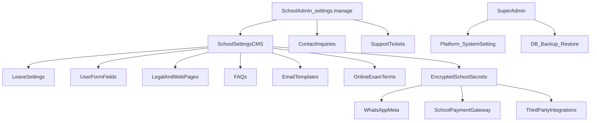

# School Admin Settings / CMS / Support — Implementation Plan

**Companion docs:** [school-admin-settings-api-audit.md](./school-admin-settings-api-audit.md), [school-admin-settings-api-test-plan.md](./school-admin-settings-api-test-plan.md)  
**Status:** Planning only — no application code or Neon migrations in this delivery.

## Locked defaults

| Decision | Choice |
|----------|--------|
| CMS / secrets / tickets / contact inquiries | **School-scoped** under `/api/v1/school-admin/...` |
| SaaS Razorpay + platform `SystemSetting` secrets | **Super Admin / env** (unchanged) |
| Full Neon backup/restore | **Super Admin only** |
| School Admin permission | Prefer `settings.manage` (`PERM_SETTINGS`); structure/media may also use `school.manage` where consistent |
| Secrets in responses | Never plaintext; return `configured: bool` (mirror [`settings_service.py`](../app/services/v1/settings_service.py)) |
| Migrations | Additive Alembic only; **explicit approval** before `alembic upgrade` on Neon |
| Frontend | Do not restore `admin-web`; preserve existing API contracts |

---

## Architecture



**Conventions:** Mount new routes via a dedicated router included from [`school_admin.py`](../app/api/v1/school_admin.py) (same pattern as [`school_admin_mgmt.py`](../app/api/v1/school_admin_mgmt.py)). Services under `app/services/v1/`. Schemas under `app/schemas/v1/`. Always take `school_id` from auth — never from client body for ownership.

---

## Phase A — School content CMS (legal + web + FAQ)

**Goal:** Replace empty `_school_settings_bootstrap` content with persisted school copy.

### Proposed tables (additive)

- `school_content_pages` — `(school_id, slug, title, body_html/text, updated_at, deleted_at)`  
  Slugs: `privacy_policy`, `terms_condition`, `refund_cancellation`, `contact_us`, `about_us`, plus optional `web_home` / `web_content`.
- `school_faqs` — `(school_id, question, answer, sort_order, status, deleted_at)`

**Do not** store long HTML in `system_settings.data` (`String(255)`).

### Endpoints

| Method | Path | Notes |
|--------|------|-------|
| GET | `/api/v1/school-admin/content/{slug}` | 404 if unknown slug |
| PUT | `/api/v1/school-admin/content/{slug}` | Upsert; validate slug allowlist |
| GET/PUT | `/api/v1/school-admin/web-content` | Alias or dedicated homepage blob |
| GET | `/api/v1/school-admin/faqs` | Paginated |
| POST | `/api/v1/school-admin/faqs` | |
| PATCH/DELETE | `/api/v1/school-admin/faqs/{id}` | Soft delete |

**Auth:** `settings.manage`  
**Follow-up (separate PR):** Wire public/mobile reads in [`student_reads.py`](../app/api/student_reads.py) to these tables so parents/students see real content.

### Schemas (sketch)

```text
ContentPageResponse: slug, title, body, updated_at
ContentPageUpsert: title?, body (max length TBD, e.g. 100_000)
FaqCreate/Patch: question, answer, sort_order?, status?
FaqResponse: id, question, answer, sort_order, status, ...
```

---

## Phase B — Leave settings + online exam terms

**Storage:** Single-row-per-school JSON or typed columns in `school_leave_settings` and `school_online_exam_terms`.

| Method | Path |
|--------|------|
| GET/PUT | `/api/v1/school-admin/leave-settings` |
| GET/PUT | `/api/v1/school-admin/online-exam-terms` |

**Validation:** Store structure only until product defines accrual/approval rules. Do **not** invent paid-leave math. Document fields as “opaque policy document + optional structured flags approved by PO.”

**Stub:** Deprecate reliance on `GET /api/leave-settings` 501; prefer v1 path (legacy stub can remain 501 or later proxy).

---

## Phase C — Email templates

**Table:** `school_email_templates` — `(school_id, key, subject, body_text, body_html?, locale?, deleted_at)`  
Unique `(school_id, key)` where active.

| Method | Path |
|--------|------|
| GET | `/api/v1/school-admin/email-templates` |
| POST | `/api/v1/school-admin/email-templates` |
| GET/PATCH/DELETE | `/api/v1/school-admin/email-templates/{id}` |

**Later:** Optional render path used by [`mailer.py`](../app/services/v1/mailer.py) — not required for first CRUD ship.

---

## Phase D — Encrypted school secrets (WhatsApp, payment gateway, third-party)

**Table:** `school_integration_secrets` — `(school_id, provider, public_config_json, secret_ciphertext, secret_configured, updated_at)`  
Providers: `whatsapp_meta`, `fee_payment_gateway`, `custom:{name}`.

| Method | Path | Response secrets |
|--------|------|------------------|
| GET/PUT | `/api/v1/school-admin/whatsapp-settings` | Masked |
| GET/PUT | `/api/v1/school-admin/payment-gateway-settings` | Masked; **does not** replace SaaS Razorpay |
| GET | `/api/v1/school-admin/third-party-integrations` | List + configured flags |
| PUT | `/api/v1/school-admin/third-party-integrations/{provider}` | Write secrets |

**Crypto:** App env key (e.g. `SCHOOL_SECRETS_FERNET_KEY`); encrypt at rest; audit sanitize ([`audit_service.py`](../app/services/v1/audit_service.py)) already redacts token-like keys — keep that.

**WhatsApp webhooks:** Real implementation later may replace stubs under `/api/whatsapp/webhook/{schoolCode}`; school code → school_id lookup with signature verification — product must specify Meta Cloud API vs BSP.

---

## Phase E — Additional user fields (definitions)

**Tables:**

- `school_form_fields` — field definition (entity: `student|staff|parent|user`, type, label, required, options_json, sort_order)
- `school_form_field_values` — optional later wave when binding to people create/update

| Method | Path |
|--------|------|
| GET/POST | `/api/v1/school-admin/user-form-fields` |
| PATCH/DELETE | `/api/v1/school-admin/user-form-fields/{id}` |

**Out of first slice:** Changing [`school_people.py`](../app/services/v1/school_people.py) create/update to require custom values — follow-up after PO approves field types.

---

## Phase F — Contact inquiries + support tickets

**Distinct from** `AdmissionInquiry` / `/admission-inquiries`.

**Tables:**

- `contact_inquiries` — name, email, phone, subject, message, status, school_id, source, deleted_at
- `support_tickets` — subject, body, status, priority, opener_type, opener_ref, school_id
- `support_ticket_messages` — ticket_id, author, body, created_at

| Method | Path | Auth |
|--------|------|------|
| GET/PATCH | `/api/v1/school-admin/contact-inquiries` | settings.manage or school.manage |
| GET/POST/PATCH | `/api/v1/school-admin/support-tickets` | settings.manage |
| POST | `/api/v1/school-admin/support-tickets/{id}/messages` | |
| POST | `/api/v1/public/schools/{code}/contact-inquiries` | Optional later; rate-limited, no auth |

**PO required:** Who may open tickets (parent/staff/public); statuses/SLA.

---

## Phase G — Super Admin database backup / restore

**Not exposed to School Admin.**

| Method | Path |
|--------|------|
| POST | `/api/v1/super-admin/backups` | Create job (async recommended) |
| GET | `/api/v1/super-admin/backups` | List metadata (no raw dump in list) |
| GET | `/api/v1/super-admin/backups/{id}` | Status + checksum + retention |
| POST | `/api/v1/super-admin/backups/{id}/restore` | Requires confirmation token + dual control if product requires |

**Safeguards (must design before coding):**

- Super Admin auth only (`require_super_admin`)
- Encrypted artifact storage; retention policy; checksum
- Audit log every create/download/restore attempt
- Restore blocked in production without explicit env flag + confirmation phrase
- Never run restore from School Admin token
- Document that shared Neon backup affects **all** tenants

**Metadata table:** `platform_backups` (id, created_by, status, size, checksum, storage_uri, expires_at) — not the dump itself in Postgres if avoidable.

---

## RBAC map

| Area | Permission |
|------|------------|
| Content, FAQ, leave settings, exam terms, email templates, integrations | `settings.manage` |
| Contact inquiries / support (school inbox) | `settings.manage` (or `school.manage` if product prefers) |
| Platform settings | Super Admin |
| Backups | Super Admin only |
| Existing sliders/gallery | Keep current mgmt perms |

---

## Tenant isolation and audit

- All school queries filter `school_id == auth.user.school_id`.
- Cross-school ID in path → 404 (preferred) or 403 — match existing school-admin pattern.
- Audit: content publish, secret updates (no secret values), ticket status changes, backup/restore.
- Regression: do not break `/api/v1/super-admin/settings`, `/api/v1/payments*`, admission-inquiries, sliders/gallery.

---

## Migration sketch

**Revision after current Alembic head** (e.g. after `20261027_0039` if present):

- Create school CMS / FAQ / leave_settings / online_exam_terms / email_templates / integration_secrets / form_fields / contact_inquiries / support_tickets(+messages) / platform_backups.
- Indexes on `(school_id, …)` and soft-delete partial uniques where needed.
- Reversible `downgrade()` drops new tables only.

**Command (when approved):** from `backend/`: `alembic upgrade head` — **not** in this planning delivery.

---

## Recommended implementation order

1. Phase A — Content + FAQ (unblocks empty mobile strings once wired)  
2. Phase B — Leave settings + online exam terms  
3. Phase C — Email templates  
4. Phase D — Encrypted integrations (WhatsApp, school payment gateway, third-party)  
5. Phase E — Form field definitions  
6. Phase F — Contact inquiries + support tickets  
7. Phase G — Super Admin backup (after security sign-off)  
8. Tests per [test plan](./school-admin-settings-api-test-plan.md); deprecate/document 501 stubs  

---

## Product-owner decisions (blocked until approved)

1. Leave policy field set (accrual, carry-forward, approval chain).  
2. Refund/cancellation and school fee-gateway charge behavior.  
3. Custom field types and target entities.  
4. WhatsApp: Meta Cloud API vs BSP; template ownership.  
5. Support ticket openers and SLA.  
6. Backup retention, key custody, restore dual-control.  
7. Public vs school-branded FAQ visibility.

---

## Out of scope for first coding waves

- Restoring `admin-web`
- Inventing payment/leave/payroll formulas
- Weakening test DB guards or running tests against live Neon
- Changing Super Admin plan/subscription mutate APIs
